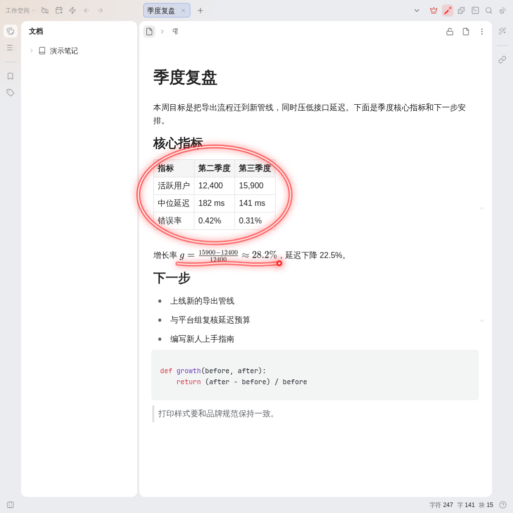

[中文](https://github.com/JeffeyChou/siyuan-laser-pointer/blob/main/README.zh-CN.md)

# Laser Pointer



Circle and point at things in your notes while you present.

* Toggle: the laser pointer icon in the top bar, or `Alt+Shift+L` (macOS: `⌥⇧L`). You can bind another key to **Laser pointer** in Settings → Keymap.
* Draw: hold the left mouse button and drag. A stroke stays for about a second after you release, then fades out.
* Scroll: the mouse wheel still scrolls the document underneath.
* Exit: `Esc`, right click, or the icon or hotkey again.
* While the laser pointer is on, notes cannot be edited or clicked. Strokes are never written into the document.

## Development

```bash
pnpm i
pnpm run build   # writes dist/ and package.zip
```

Unzip `package.zip` into `{workspace}/data/plugins/siyuan-laser-pointer/` to install a local build.

## License

MIT
